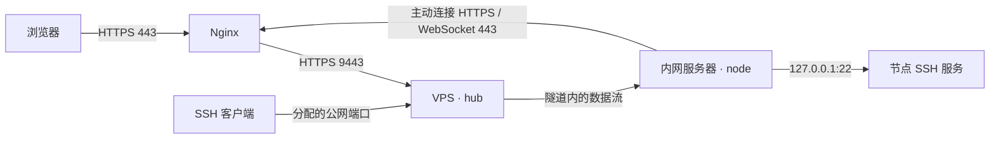

# NodeBridge

**Deployment Best Practices · 部署最佳实践**

通过一台 VPS，连接没有公网 IP 的服务器。安装后复制一次配对链接，即可获得固定的公网 SSH 端口，并在 Web 面板集中管理节点与版本。

以下命令适用于 Ubuntu / Debian、systemd、amd64 / arm64。将所有 `ssh.example.com` 替换为你的域名。已有部署直接看[升级](#升级)。

## 1. 确认域名解析

开始前，域名的 **A 记录已指向 VPS 公网 IPv4**。只有 VPS 的 IPv6 同样可访问时才添加 AAAA 记录。域名应直接解析到 VPS，不开启 CDN 代理。

在 VPS 的云安全组和本机防火墙放行：

| TCP 端口 | 用途 |
| --- | --- |
| 80 | 申请与续期域名证书 |
| 443 | Web 面板、节点连接 |
| 30000–39999 | 分配给节点的公网 SSH 端口 |

如果使用 UFW：

```bash
sudo ufw allow 80/tcp
sudo ufw allow 443/tcp
sudo ufw allow 30000:39999/tcp
```

本地节点只需能向 VPS 的 443 端口发起连接，无需公网 IP 或入站端口映射。以下部署方式无需向公网开放 9443。

## 2. 配置 Nginx 和域名证书

在 **VPS** 执行。已有 Nginx 站点和证书的用户，按 [Nginx 配置说明](docs/NGINX.md)检查 HTTPS 上游与 WebSocket 转发后，进入第 3 步；下面的建站命令用于新站点。

```bash
sudo apt update
sudo apt install -y nginx certbot python3-certbot-nginx curl ca-certificates

NB_DOMAIN=ssh.example.com

sudo tee "/etc/nginx/sites-available/$NB_DOMAIN.conf" > /dev/null <<EOF
map \$http_upgrade \$nodebridge_connection_upgrade {
    default upgrade;
    '' close;
}

server {
    listen 80;
    listen [::]:80;
    server_name $NB_DOMAIN;

    location / {
        proxy_pass https://127.0.0.1:9443;
        proxy_http_version 1.1;
        proxy_set_header Host \$http_host;
        proxy_set_header X-Real-IP \$remote_addr;
        proxy_set_header X-Forwarded-For \$proxy_add_x_forwarded_for;
        proxy_set_header X-Forwarded-Proto \$scheme;
        proxy_set_header Upgrade \$http_upgrade;
        proxy_set_header Connection \$nodebridge_connection_upgrade;
        proxy_ssl_server_name on;
        proxy_ssl_name $NB_DOMAIN;
        proxy_ssl_verify off;
        proxy_read_timeout 3600s;
        proxy_send_timeout 3600s;
        proxy_buffering off;
    }
}
EOF

sudo ln -sfn "/etc/nginx/sites-available/$NB_DOMAIN.conf" "/etc/nginx/sites-enabled/$NB_DOMAIN.conf"
sudo nginx -t && sudo systemctl enable --now nginx
sudo systemctl reload nginx
sudo certbot --nginx -d "$NB_DOMAIN" --redirect
sudo systemctl enable --now certbot.timer
```

**上游 9443 必须使用 HTTPS**。浏览器和节点使用 Nginx 的域名证书，Nginx 通过本机回环连接 Hub 的自签证书。安装 Hub 前访问域名出现 502 属于正常现象。

## 3. 安装 VPS 端

在 **VPS** 安装 Hub，公网地址填写域名，不加 `:9443`：

```bash
curl -fsSL https://github.com/johnfan12/NodeBridge/releases/latest/download/install.sh | sudo bash -s -- hub --public-url https://ssh.example.com
```

读取首次管理员账号与密码：

```bash
sudo cat /var/lib/nodebridge/hub/initial-admin.txt
```

打开 `https://ssh.example.com`，登录并修改初始密码。进入 **管理页面 → 服务器 → 接入服务器**，填写节点名称，生成配对链接。

## 4. 安装本地节点并使用 SSH

在 **需要被连接的本地服务器** 执行：

```bash
sudo apt update
sudo apt install -y curl ca-certificates openssh-server
sudo systemctl enable --now ssh

curl -fsSL https://github.com/johnfan12/NodeBridge/releases/latest/download/install.sh | sudo bash -s -- node

nodebridge pair
```

按提示粘贴 VPS 生成的配对链接。链接只能使用一次，15 分钟有效。也可以在本地服务器打开 `http://127.0.0.1:9899` 粘贴链接。

回到 VPS 面板，等待节点显示 **SSH 就绪**，点击 **SSH 连接**，填写本地服务器已有的 Linux 用户名，复制命令连接。公网 SSH 端口自动分配；认证使用该 Linux 用户的密码或 SSH 密钥，面板账号不等于 Linux 账号。

## 通过域名转发 Overleaf

1. 将独立域名（例如 `overleaf.example.com`）直接解析到 Hub VPS，确保 80 和 443 可访问。已有的 SSH 控制台继续使用自己的域名。
2. VPS 安装 Nginx 和 Certbot（第 2 步）。首次启用此功能，使用包含此功能的安装脚本安装 Hub，以创建 `nodebridge-sites.socket`。仅替换二进制的面板升级无法创建新的 systemd 单元。
3. 在 **管理页面 → 端口转发管理** 输入域名并点击 **注册**。Hub 保留一个 41000–41999 范围内的 VPS 回环端口，配置 Nginx 并通过 HTTP-01 申请证书。只开放公网 80/443。注册失败可修正 DNS 后重试同一域名。
4. 点击 **添加 Overleaf 服务器**，复制一次性配对链接。在节点维护页 `http://127.0.0.1:9899` 的右上角点击 **端口转发**，填入链接和本机 HTTP 端口，点击 **配对并转发**。默认目标是 `127.0.0.1:80`；若 Docker 映射到了 8080，则填写 8080。
5. 在浏览器打开 `https://overleaf.example.com`。Overleaf 的站点地址应设置为这个 HTTPS 地址。需要停用时，管理员可撤销配对，节点也可以单独断开端口转发。

## 升级

安装脚本会检查在线升级所需的目录权限。遇到权限提示或监听器启动限流时，见[执行器恢复步骤](docs/UPDATES.md#修复更新目录权限)。

### 面板升级

管理员进入 **管理页面 → 版本更新 → 检查更新**，查看 Hub 和各节点版本，手动点击对应的升级按钮。检查更新不会自动安装；下载和校验期间服务继续运行。

安装阶段会重启服务并断开对应 SSH 会话，Hub 升级影响全部节点。账号、配对、固定端口、暂停状态和证书保留。建议在没有 SSH 任务时升级。

### 命令升级

普通升级自动读取已有配置，**无需填写 URL，也无需添加 `--reconfigure`**。旧版本没有面板升级能力，或页面提示未安装更新执行器时，先在两端各执行一次以下命令。

**VPS：**

```bash
curl -fsSL https://github.com/johnfan12/NodeBridge/releases/latest/download/install.sh | sudo bash -s -- hub
```

**每台已配对节点：** 用独立后台任务更新，避免 SSH 断开时终止安装：

```bash
sudo systemd-run --unit=nodebridge-node-bootstrap --collect /bin/bash -c '
set -euo pipefail
curl -fsSL https://github.com/johnfan12/NodeBridge/releases/latest/download/install.sh |
  bash -s -- node
'
```

查看该任务日志：

```bash
sudo journalctl -u nodebridge-node-bootstrap -n 80 --no-pager
```

未配对节点按第 4 步安装即可。下载失败、离线升级与面板更新排障见[升级说明](docs/UPDATES.md)。

### 修改连接地址

仅在更换域名，或将旧的 `域名:9443` 切换到域名 443 入口时，才需要显式修改地址：VPS 安装命令在 `hub` 后追加 `--public-url https://ssh.example.com --reconfigure`；节点安装命令在 `node` 后追加 `--hub-url https://ssh.example.com --tls-mode auto --reconfigure`。先确认 Nginx 已正确配置，具体步骤见 [地址迁移说明](docs/NGINX.md#将临时的-9443-入口切回域名-443)。

## 卸载

通过 VPS 自身 SSH 或节点的本地 / 局域网终端执行。卸载会停止对应 Web 页面与 SSH 转发。

```bash
# 本地节点
curl -fsSL https://github.com/johnfan12/NodeBridge/releases/latest/download/uninstall.sh | sudo bash -s -- node --purge

# VPS
curl -fsSL https://github.com/johnfan12/NodeBridge/releases/latest/download/uninstall.sh | sudo bash -s -- hub --purge

# 同一台机器同时卸载两种模式
curl -fsSL https://github.com/johnfan12/NodeBridge/releases/latest/download/uninstall.sh | sudo bash -s -- all --purge
```

**`--purge` 永久删除对应配置、凭证与数据库。** 去掉它可保留数据，供重新安装使用。清空节点数据后需要重新配对；清空 Hub 数据后需要重建账号并让全部节点重新配对。卸载节点后，在 VPS 面板移除该节点可回收端口。

## 维护

### 状态、日志与连接检查

```bash
# 当前版本
nodebridge version

# VPS 服务与公网入口检查
sudo systemctl status nodebridge-hub --no-pager
sudo journalctl -u nodebridge-hub -n 80 --no-pager
sudo nodebridge doctor --data-dir /var/lib/nodebridge/hub

# 本地节点服务与连接状态
sudo systemctl status nodebridge-node --no-pager
sudo journalctl -u nodebridge-node -n 80 --no-pager
curl -fsS http://127.0.0.1:9899/api/node

# 面板发起的节点升级日志；VPS 升级将 node 改为 hub
sudo journalctl -u nodebridge-update-node -n 80 --no-pager

# VPS 域名证书续期检查
sudo certbot renew --dry-run
```

节点维护页：`http://127.0.0.1:9899`。Hub 数据位于 `/var/lib/nodebridge/hub/`，节点数据位于 `/var/lib/nodebridge/node/`，各自的 `config.json` 保存配置。备份与恢复见[运维说明](docs/OPERATIONS.md)。

### 显卡快照与历史可用性

服务器列表右侧显示“可用 3/4”等显卡数量指标，点击“详情”查看各卡利用率、显存、温度、功耗和过去 30 天的在线 / SSH 就绪记录。

v0.6.0 节点首次连接时采集显卡快照，之后在线期间每 20 分钟采集一次；刷新页面不会触发采集。详情显示采集时间，离线或过期数据会标注。“可用”按利用率低于 10% 且已用显存低于 1 GiB 估算，不代表资源预留。SSH 状态仍每 10 秒检查，历史记录仍每 30 秒采样。

需要同时升级 Hub 和节点才能启用新的采集频率；旧节点可以继续连接，详情会提示升级节点。

### 暂停与恢复 SSH 转发

| 操作位置 | 方法 | 范围 |
| --- | --- | --- |
| VPS 管理页面 | 服务器 → 全局 SSH 转发设置 → 暂停 / 恢复 | 全部节点 |
| VPS 服务器列表 | 暂停节点转发 / 恢复节点转发 | 所选节点 |
| 节点本地维护页 | 连接状态 → 暂停 SSH 转发 / 恢复 SSH 转发 | 本机节点 |

暂停会立即断开范围内的 SSH 会话与文件传输，Web、配对与状态上报继续运行。原端口保留，恢复后无需重新配对。三个位置的暂停开关独立生效，需要分别恢复；暂停状态在重启与升级后保留。

需要连 Web 一起停止时，通过直接维护终端执行：

```bash
# 在节点执行；VPS 将 nodebridge-node 改为 nodebridge-hub
sudo systemctl stop nodebridge-node
sudo systemctl start nodebridge-node

# 重启服务
sudo systemctl restart nodebridge-node
```

## 项目架构

一个 Go 二进制提供两种模式：VPS 运行 `hub`，负责 Web 控制台、账号、配对与端口分配；内网服务器运行 `node`，主动建立隧道并转发本机 SSH。WebUI 内嵌，数据保存在本机，无需额外部署数据库。



SSH 和 Overleaf 使用独立的配对凭证与隧道。更多细节：[架构](docs/ARCHITECTURE.md) · [迁移](docs/MIGRATION.md) · [Release 下载](https://github.com/johnfan12/NodeBridge/releases/latest)。
